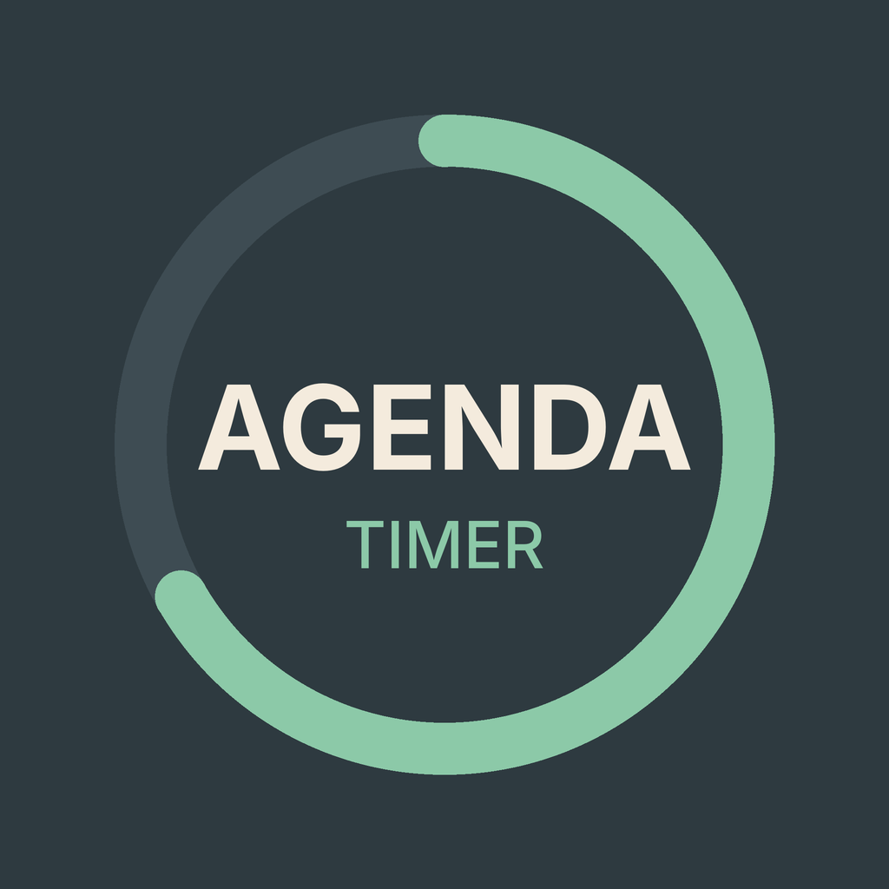

# Agenda Timer

A Discord bot that keeps group meetings on schedule. It posts a shared timer panel in a voice channel's chat, counts down each agenda item, and plays a soft chime in the voice channel when time is up.

I built it for a weekly job search accountability group that meets in Discord. Existing timer bots either needed a separate channel for every timer, took too long to reconfigure between activities, or asked for more account access than a timer should need. This bot does one job inside the channel the group is already using, and it asks for no access to members' messages or personal information.

## How it works

Type `/timer` in a voice channel's chat. The bot posts a panel:

```
[ Choose activity        ▾ ]
[ Choose duration        ▾ ]
[Start] [Pause] [+1 min] [🔔 Done]
[⬇️ Move to bottom] [Exit timer]
```

| Button | What it does |
|---|---|
| Start | Starts the countdown. The bot joins the voice channel if anyone is in it. |
| Pause / Resume | Pauses or resumes the countdown. |
| +1 min | Adds a minute. Also works after time is up, for groups that need a little longer. |
| 🔔 Done | Ends the activity early, with the chime. |
| Move to bottom | Reposts the panel below the latest chat messages. The timer keeps running. |
| Exit timer | Removes the panel. The bot leaves voice. |

Buttons that can't be used at the moment are greyed out, and the bottom of the panel shows who made the last change (for example, "Paused by Kathy").

When an activity ends, the bot posts a record in the chat:

- `⏰ Time's up: Discussion (17 min)` when the timer runs out, including any added minutes
- `✅ Done: Discussion (9 min)` when someone presses Done
- `⚠️ Incomplete: Discussion (4 min)` when everyone leaves the voice channel mid-activity

Countdown times use Discord's timestamp format, so each person sees times in their own time zone.

## Design choices

- **Works only in voice channel chats.** The bot joins only the voice channel the panel belongs to, never a channel a member happens to be in elsewhere.
- **Joins and leaves with the group.** The bot enters voice only when people are there: when a timer starts with someone in the voice channel, or when someone arrives during a timer. It leaves when the last person does, so it never sits in an empty channel.
- **Minimal permissions.** No privileged intents. The bot can't read members' messages.
- **No extra audio software.** The chime is a WAV file in the exact format Discord voice uses, so FFmpeg isn't required.

## Behavior details

- **Start is greyed out while a timer is running or paused**, so nobody resets the countdown by accident. To switch activities, press Done, choose the next activity and duration, then press Start.
- **+1 min works after time is up, but not after Done.** Running out of time is automatic, so the group may still need a minute. Done is a deliberate choice to close the activity.
- **If everyone leaves the voice channel mid-activity**, the timer stops, the panel turns grey and shows Incomplete, and the bot posts how long the activity ran. Pause, +1 min, and Done are greyed out until someone presses Start. The panel stays in the chat: only Exit timer removes it, and Move to bottom replaces it with a fresh copy.
- **The chime plays only if someone is in the voice channel.** A timer that runs out in an empty channel still posts its message.
- **Two panels can run in the same channel**, for example one for the whole meeting and one for each activity. Exit timer on one panel keeps the bot in voice while the other is still timing.
- **The bot can be in only one voice channel per server.** This is a Discord limit, so timers in two voice channels of the same server at once (such as breakout groups) aren't supported yet.
- **If the bot restarts, existing panels stop responding.** Type `/timer` for a new panel and delete the old ones. On startup, the bot also clears any leftover voice connection.
- **The "ends in" countdown is redrawn by each person's Discord app**, not by the bot. It may tick every second or update less often, for example in busier calls or when Discord isn't the active window. The end time and chime are exact either way.

## Setup (Windows)

1. **Create the bot.** In the [Discord Developer Portal](https://discord.com/developers/applications), create an application, open the Bot tab, and copy the token. Leave all Privileged Gateway Intents off.
2. **Invite it.** Under OAuth2 → URL Generator, select the `bot` and `applications.commands` scopes and these permissions: View Channels, Send Messages, Embed Links, Read Message History, Connect, Speak. Open the generated link and choose your server.
3. **Install.** You need Python 3.9 or newer. Open Command Prompt in the folder that holds these files: either open the folder in File Explorer, type `cmd` in the address bar, and press Enter, or open Command Prompt and move into the folder with `cd`, for example `cd %USERPROFILE%\agenda-timer`. Then run these lines one at a time:
   ```
   python -m venv .venv
   .venv\Scripts\activate
   pip install -r requirements.txt
   ```
4. **Add the token.** Create a text file named `token.txt` and save it into the folder you opened in step 3. Include only the token in the file, with no labels or notes. The repository's `.gitignore` file tells Git to skip `token.txt`, so it is never uploaded to GitHub.
5. **Run.** Double-click `start_bot.bat`, a Windows shortcut script included in this repository that opens Discord and starts the bot. Alternatively, with the environment from step 3 active, run `python bot.py`. Press Ctrl+C in the bot's window to stop it cleanly.

## Customizing

At the top of `bot.py`:

- `ACTIVITIES` and `DURATIONS` set the two menus.
- `ALERT_SOUND` sets the chime file. Any replacement must be a WAV file at 48000 Hz, 16-bit, stereo. `make_natural_sound.py` can generate a spoken alert in that format.

## Files

| File | Purpose |
|---|---|
| `bot.py` | The bot |
| `start_bot.bat` | Opens Discord and starts the bot |
| `chime.wav` | The alert sound |
| `make_natural_sound.py` | Optional: creates a spoken alert |
| `requirements.txt` | Python packages to install |
| `C_agenda_ring.png` | The bot's profile picture |

## Built with

Python and [discord.py](https://github.com/Rapptz/discord.py).
